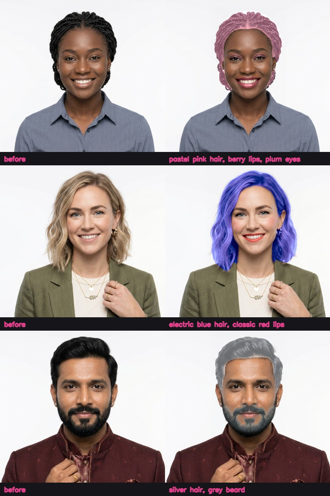
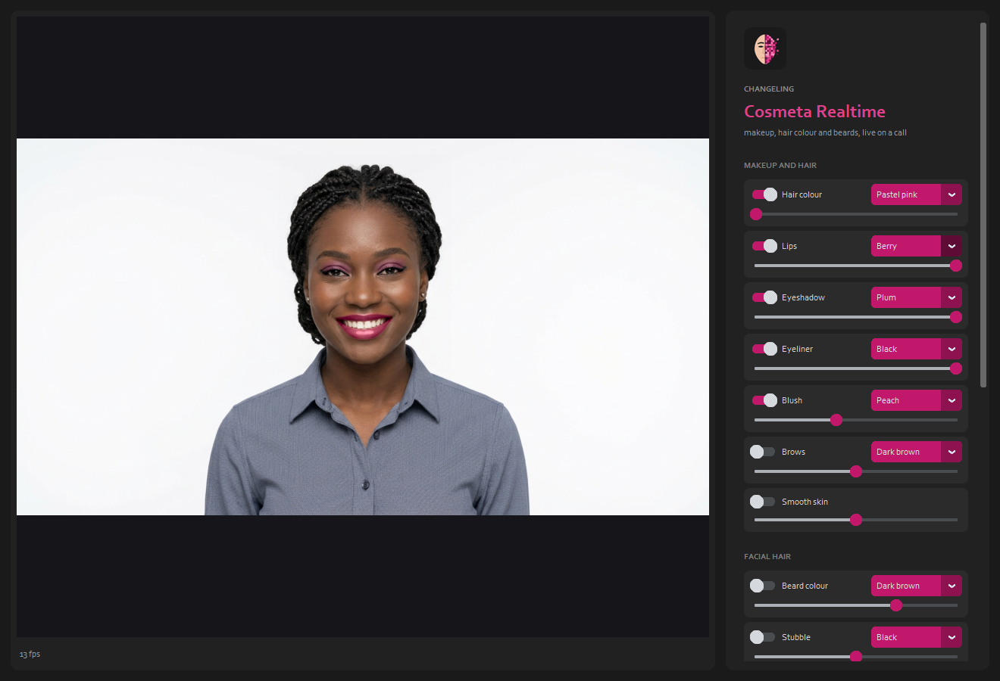
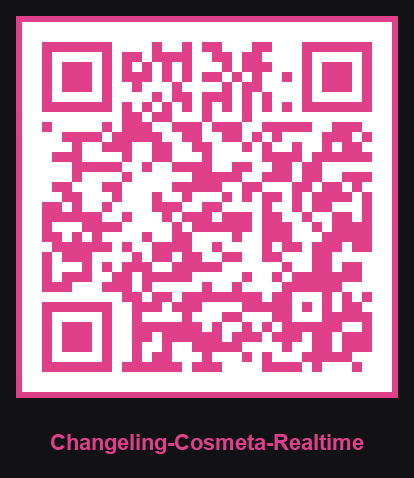

  

# Changeling Cosmeta Realtime

**Website:** https://cursedprograms.github.io/Changeling-Cosmeta-Realtime/

Makeup, hair colour and beards, live on a video call. Changeling Cosmeta' looks, painted on every frame of your webcam (or your phone's camera): hair colour, lips, eyeshadow, eyeliner, blush, brows, smooth skin, beard colour, stubble and a shave, each with its colour and strength, and the editor's brightness, contrast, warmth and vignette, out to the call through OBS Virtual Camera.

*Part of the Changeling family, all together in [Changeling Studio](https://github.com/CursedPrograms/Changeling-Studio):
[CopyCat](https://github.com/CursedPrograms/Changeling-CopyCat) ·
[CopyCat Realtime](https://github.com/CursedPrograms/Changeling-CopyCat-Realtime) ·
[Tiresias](https://github.com/CursedPrograms/Changeling-Tiresias) (gender) ·
[Chronos](https://github.com/CursedPrograms/Changeling-Chronos) (age) ·
[Natio](https://github.com/CursedPrograms/Changeling-Natio) (where in the world) ·
[Cosmeta](https://github.com/CursedPrograms/Changeling-Cosmeta) (makeup, hair, beards) ·
[Echo](https://github.com/CursedPrograms/Changeling-Echo) (voices) ·
[Tonsor](https://github.com/CursedPrograms/Changeling-Tonsor) (hairstyles) ·
realtime: [Tiresias](https://github.com/CursedPrograms/Changeling-Tiresias-Realtime) ·
[Chronos](https://github.com/CursedPrograms/Changeling-Chronos-Realtime) ·
[Natio](https://github.com/CursedPrograms/Changeling-Natio-Realtime) · **Cosmeta**.*

## How it's live

[Changeling Cosmeta](https://github.com/CursedPrograms/Changeling-Cosmeta) reads a photo with a SegFormer face
parser: careful, but about a second a picture. Live, the face is read with BiSeNet on the graphics card (the same
19 labels, a few hundredths of a second, twice: a wide square for the hair and a close one for the face's parts),
and Face Mesh follows the face from frame to frame. The looks are Cosmeta's own code, painted only in the box
around the face and hair, at most 420 pixels across, with only the change scaled back up. Reading the next frame
and painting the last run side by side. Measured here (a 6 GB card, five looks on, long hair): about 13 frames a
second at 1280 x 720.

## Use it

1. Python 3.11, an NVIDIA GPU, a webcam; [OBS](https://obsproject.com/) for its Virtual Camera.
2. Start `run.bat` (or `run.ps1`, `run.sh`). It runs in
   [Changeling CopyCat Realtime](https://github.com/CursedPrograms/Changeling-CopyCat-Realtime)'s environment with
   Changeling Cosmeta' code, both next to this folder as in
   [Changeling Studio](https://github.com/CursedPrograms/Changeling-Studio); missing ones are cloned there, and
   CopyCat Realtime is set up the first time. BiSeNet's weights (50 MB) are taken from `F:\AIModels\face` or
   HairFastGAN's models if they're on the PC, else downloaded once.
3. Switch on what you want; pick its colour; slide its strength. **Before | after** shows both in the window
   (the call gets only the after). In the call, pick **OBS Virtual Camera**.
4. **Your phone as the camera:** `run_server.bat` (or `run.bat --phone`) shows a QR code. Scan it on the same
   WiFi, accept the certificate warning once and press Start. It's CopyCat Realtime's phone page.

`run.bat --camera 1` (another webcam), `run.bat --source me.jpg` (a photo or a video instead, for trying it out),
`run.bat --no-virtual` (just the window).

## Its limits

- The hair colour follows the parser's hair outline: on fine, flyaway or braided hair a thin light edge can show
  between the hair and the background.
- Beard colour and the shave work best on a beard you have; for a new beard style, Changeling Cosmeta (photos) has
  AetherCanvas AI's edits.

## Licenses

MIT. BiSeNet face parsing is [zllrunning/face-parsing.PyTorch](https://github.com/zllrunning/face-parsing.PyTorch)
(MIT).

---

 

© Cursed Entertainment 2026

 

 

  

